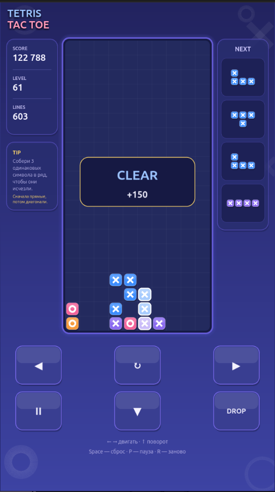
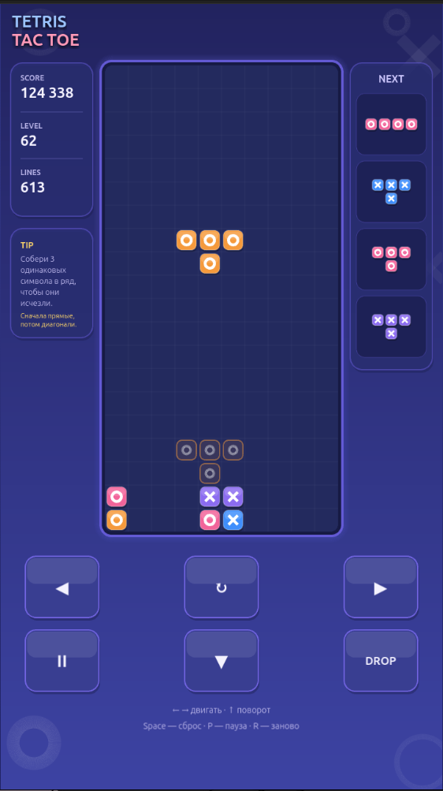

# Tetris Tac Toe

| Screenshot 1 | Screenshot 2 |
| :---: | :---: |
|  |  |


Минимальный рабочий прототип игры-гибрида тетриса и крестиков-ноликов на Phaser 4 + TypeScript + Vite.

## Запуск

```bash
npm install
npm run dev
```

Сборка: `npm run build`, предпросмотр: `npm run preview`.

## Правила

- Сверху падают фигуры из 4 клеток. Каждая клетка — символ **X** или **O**.
- Собери **3 одинаковых символа в ряд** по горизонтали, вертикали или диагонали — они исчезнут.
- Приоритет очистки: сначала проверяются **горизонтальные и вертикальные** линии. Диагонали учитываются только если прямых линий нет.
- Линия засчитывается, только если в ней есть клетки упавшей фигуры **и** клетки, которые уже лежали на поле. Поэтому фигура не может уничтожить саму себя сразу после приземления.
- После исчезновения клетки сверху падают вниз. Если гравитация собрала новую линию, она очищается отдельным шагом — за один шаг исчезают линии только одного символа.
- **Комбо:** каждая следующая очистка в одной серии (каскаде) умножает очки. Пороги, названия плашек и награды настраиваются в `src/game/comboConfig.ts`.
- Очки: 50 за клетку × множитель комбо + бонус плашки, +1 за мягкий сброс, +2 за каждую клетку жёсткого сброса.
- Каждые 10 очищенных линий повышают уровень и ускоряют падение.
- Игра заканчивается, когда новая фигура не помещается на поле.

## Настройка комбо

Все плашки и награды задаются в `src/game/comboConfig.ts`:

```ts
export const COMBO_CONFIG: ComboTier[] = [
    { cascades: 1, label: 'CLEAR', color: '#9cc4ff', multiplier: 1 },
    { cascades: 2, label: 'COMBO ×2', color: '#ffd76a', multiplier: 2 },
    { cascades: 5, label: 'MEGA COMBO', color: '#ff6b8a', multiplier: 5, bonus: 250 },
];
```

| Поле | Что задаёт |
| --- | --- |
| `cascades` | Сколько очисток подряд нужно, чтобы включилась эта плашка |
| `label` | Текст плашки |
| `color` | Цвет текста плашки |
| `multiplier` | Множитель очков за каждую очищенную клетку |
| `bonus` | Дополнительные очки за шаг (необязательно) |

Для каскада берётся запись с **наибольшим `cascades`, который не превышает номер каскада**. Поэтому можно указывать не каждый шаг, а только нужные пороги. В примере выше:

- каскад 1 — `CLEAR`, ×1;
- каскады 2–4 — `COMBO ×2`, ×2;
- каскад 5 и больше — `MEGA COMBO`, ×5 и +250 очков.

Формула: `клетки × 50 × multiplier + bonus`.

## Управление

| Действие | Клавиатура | Кнопки |
| --- | --- | --- |
| Движение | ← → / A D | ◀ ▶ |
| Поворот | ↑ / W / X | ↻ |
| Мягкий сброс | ↓ / S | ▼ |
| Жёсткий сброс | Space | DROP |
| Пауза | P | II |
| Заново | R | тап по оверлею |

## Структура

- `src/game/model.ts` — поле, фигуры, поиск линий из 3+, гравитация.
- `src/game/comboConfig.ts` — пороги, названия и награды плашек комбо.
- `src/game/Game.ts` — состояние игры: спавн, движение, блокировка, очистка, счёт.
- `src/scenes/MainScene.ts` — отрисовка интерфейса и поля, ввод, игровой цикл.
