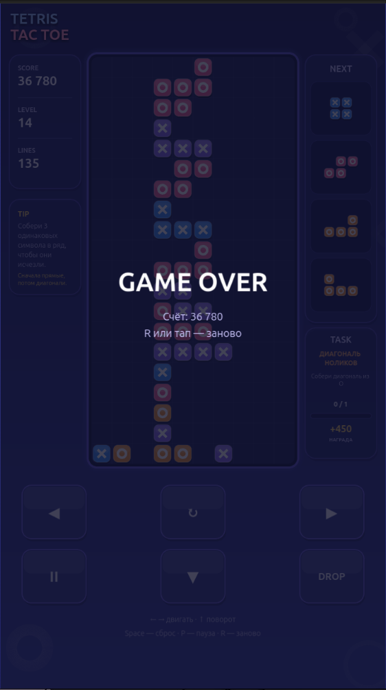
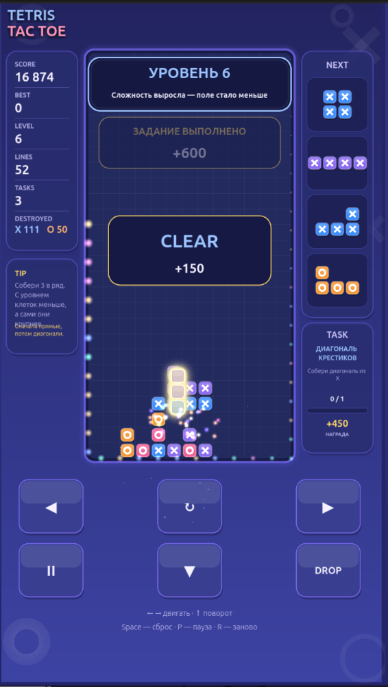
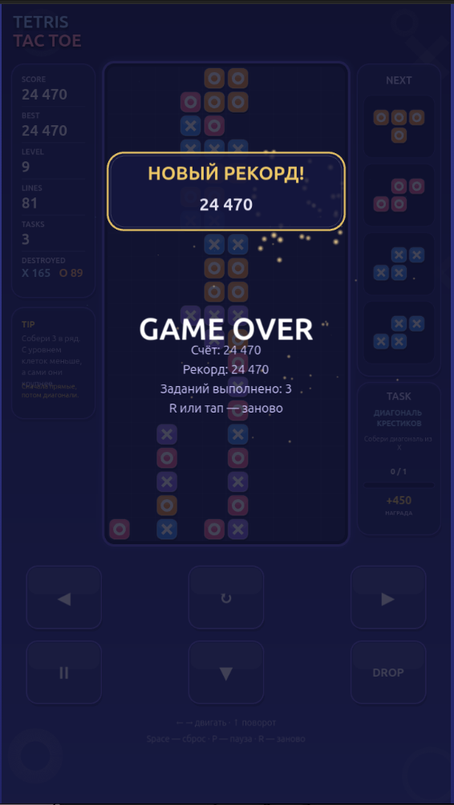

# Tetris Tac Toe

| Screenshot 1 | Screenshot 2 | Screenshot 3 |
| :---: | :---: | :---: |
|  |  |  |


Минимальный рабочий прототип игры-гибрида тетриса и крестиков-ноликов на Phaser 4 + TypeScript + Vite.

## Запуск

```bash
npm install
npm run dev
```

Сборка: `npm run build`, предпросмотр: `npm run preview`.

## Правила

- Сверху падают фигуры из 4 клеток. Каждая клетка — символ **X** или **O**.
- Собери **3 одинаковых символа в ряд** по горизонтали, вертикали или диагонали — они исчезнут.
- Приоритет очистки: сначала проверяются **горизонтальные и вертикальные** линии. Диагонали учитываются только если прямых линий нет.
- Линия засчитывается, только если в ней есть клетки упавшей фигуры **и** клетки, которые уже лежали на поле. Поэтому фигура не может уничтожить саму себя сразу после приземления.
- После исчезновения клетки сверху падают вниз. Если гравитация собрала новую линию, она очищается отдельным шагом — за один шаг исчезают линии только одного символа.
- **Комбо:** каждая следующая очистка в одной серии (каскаде) умножает очки. Пороги, названия плашек и награды настраиваются в `src/game/comboConfig.ts`.
- **Задания:** в начале игры случайно выбирается задание, например собрать горизонтальную линию из X или диагональ из O. За выполнение начисляются дополнительные очки, после чего выбирается новое задание. Список заданий и награды настраиваются в `src/game/taskConfig.ts`.
- Очки: 50 за клетку × множитель комбо + бонус плашки, +1 за мягкий сброс, +2 за каждую клетку жёсткого сброса, плюс награда за выполненное задание.
- Каждые 10 очищенных линий повышают уровень. При повышении уровня появляется уведомление «УРОВЕНЬ N» с сообщением о возросшей сложности; если размер поля действительно уменьшился, в нём также сказано, что поле стало меньше. Вокруг рамки поля дважды пробегает кольцо частиц. Рамка поля остаётся стандартной, но количество клеток внутри неё уменьшается: на 1-м уровне поле 18×36, на 40-м — 6×12. Поэтому сами клетки становятся крупнее, а фигуры занимают всё большую часть поля. Превью следующих фигур использует тот же размер клетки, что и поле, и не уменьшается. Скорость падения задаётся конфигом; в текущей конфигурации задержка одинакова на всех уровнях — 120 мс.
- В левой панели статистики показываются очки, лучший счёт за предыдущие игровые сессии (`BEST`), уровень, очищенные линии, количество выполненных заданий и число уничтоженных клеток отдельно для X и O (`DESTROYED`). Счётчик заданий увеличивается на 1 за каждую награду; вместе со счётчиками уничтоженных клеток он сбрасывается при новой игре. Рекорд сохраняется в `localStorage` и обновляется, когда текущая сессия завершается или перезапускается со счётом выше предыдущего. Если игра закончилась с новым рекордом, поверх экрана `GAME OVER` появляется плашка «НОВЫЙ РЕКОРД!» и запускается фейерверк из частиц.
- Игра заканчивается, когда новая фигура не помещается на поле.

## Настройка комбо

Все плашки и награды задаются в `src/game/comboConfig.ts`:

```ts
export const COMBO_CONFIG: ComboTier[] = [
    { cascades: 1, label: 'CLEAR', color: '#9cc4ff', multiplier: 1 },
    { cascades: 2, label: 'COMBO ×2', color: '#ffd76a', multiplier: 2 },
    { cascades: 5, label: 'MEGA COMBO', color: '#ff6b8a', multiplier: 5, bonus: 250 },
];
```

| Поле | Что задаёт |
| --- | --- |
| `cascades` | Сколько очисток подряд нужно, чтобы включилась эта плашка |
| `label` | Текст плашки |
| `color` | Цвет текста плашки |
| `multiplier` | Множитель очков за каждую очищенную клетку |
| `bonus` | Дополнительные очки за шаг (необязательно) |

Для каскада берётся запись с **наибольшим `cascades`, который не превышает номер каскада**. Поэтому можно указывать не каждый шаг, а только нужные пороги. В примере выше:

- каскад 1 — `CLEAR`, ×1;
- каскады 2–4 — `COMBO ×2`, ×2;
- каскад 5 и больше — `MEGA COMBO`, ×5 и +250 очков.

Формула: `клетки × 50 × multiplier + bonus`.

## Настройка заданий

Все задания задаются в `src/game/taskConfig.ts`. При старте игры и после выполнения текущего задания случайно выбирается одна запись из `TASK_CONFIG` (предыдущее задание не повторяется):

```ts
export const TASK_CONFIG: TaskDefinition[] = [
    {
        id: 'x-horizontal',
        title: 'РЯД КРЕСТИКОВ',
        description: 'Собери горизонтальную линию из X',
        symbol: 'X',
        direction: 'horizontal',
        target: 1,
        reward: 300,
    },
];
```

| Поле | Что задаёт |
| --- | --- |
| `id` | Уникальный идентификатор задания |
| `title` | Короткий заголовок на плашке задания |
| `description` | Текст задания |
| `symbol` | Нужный символ: `'X'`, `'O'` или `'any'` |
| `direction` | Направление линии: `'horizontal'`, `'vertical'`, `'diagonal'` или `'any'` |
| `target` | Сколько подходящих линий нужно очистить |
| `minLength` | Минимальная длина линии, по умолчанию 3 |
| `reward` | Награда в очках |

Прогресс задания увеличивается, когда на поле очищается подходящая линия. После достижения `target` начисляется `reward`, показывается плашка «ЗАДАНИЕ ВЫПОЛНЕНО» и выбирается новое задание. Чтобы добавить своё задание, достаточно дописать объект в `TASK_CONFIG`.

## Настройка сложности

Количество клеток и скорость падения по уровням задаются в `src/game/difficultyConfig.ts`:

```ts
export const LINES_PER_LEVEL = 10;

export const DIFFICULTY_CONFIG: DifficultyTier[] = [
    { level: 40, cols: 6, rows: 12, dropDelay: 120 },
    { level: 20, cols: 8, rows: 16, dropDelay: 120 },
    { level: 10, cols: 9, rows: 18, dropDelay: 120 },
    // ...
    { level: 1, cols: 18, rows: 36, dropDelay: 120 },
];
```

| Поле | Что задаёт |
| --- | --- |
| `level` | С какого уровня действует запись |
| `cols` | Количество колонок внутри поля |
| `rows` | Количество строк внутри поля |
| `dropDelay` | Задержка автоматического падения фигуры, мс (меньше — быстрее) |

`LINES_PER_LEVEL` задаёт, сколько очищенных линий нужно для следующего уровня. Для текущего уровня берётся запись с **наибольшим `level`, который не больше текущего**. Порядок записей в массиве при этом не важен: сейчас они перечислены по убыванию, но результат был бы таким же и при возрастании. Промежуточные уровни наследуют ближайшую подходящую настройку.

Рамка поля всегда остаётся стандартной, как на первом уровне. В текущем конфиге с уровнем клеток становится меньше, поэтому каждая клетка, наоборот, крупнее: `18 × 36` даёт клетку ≈21 px, а `6 × 12` — ≈63 px. Фигуры по-прежнему состоят из 4 клеток, но занимают всё большую часть поля. Превью следующих фигур использует тот же размер клетки, что и поле, без отдельного уменьшения; ограничение действует только на случай, когда фигура иначе не поместилась бы в слот.

В текущем конфиге `rows` везде равен `2 × cols`: это соглашение записей, чтобы квадратные клетки заполняли рамку без пустых полей по краям. Код это не проверяет и не подставляет значение по умолчанию — `rows` обязательное поле. `dropDelay` во всех записях равен 120 мс, то есть падение с уровнем не ускоряется.

При повышении уровня сетка меняется прямо во время очистки: уцелевшие клетки остаются прижатыми к низу и центрируются по горизонтали, а клетки, оказавшиеся за новой границей, отбрасываются. Анимация очистки показывает поле в предыдущем размере, поэтому пульсирующее свечение и взрыв частиц соответствуют старым координатам.

`difficultyFor()` ограничивает значения: `cols` и `rows` не меньше 4, `dropDelay` не меньше 80 мс. `FALLBACK_DIFFICULTY` (`10 × 20`, 800 мс) используется, если конфиг пуст или в нём нет записи с `level <= текущего`.

## Управление

| Действие | Клавиатура | Кнопки |
| --- | --- | --- |
| Движение | ← → / A D | ◀ ▶ |
| Поворот | ↑ / W / X | ↻ |
| Мягкий сброс | ↓ / S | ▼ |
| Жёсткий сброс | Space | DROP |
| Пауза | P | II |
| Заново | R | тап по оверлею |

## Структура

- `src/game/model.ts` — поле, фигуры, поиск линий из 3+, гравитация.
- `src/game/difficultyConfig.ts` — размер поля и скорость падения по уровням.
- `src/game/comboConfig.ts` — пороги, названия и награды плашек комбо.
- `src/game/taskConfig.ts` — список заданий, случайный выбор и проверка прогресса.
- `src/game/bestScore.ts` — загрузка и сохранение лучшего счёта между сессиями.
- `src/game/Game.ts` — состояние игры: спавн, движение, блокировка, очистка, задания, счёт.
- `src/scenes/MainScene.ts` — отрисовка интерфейса и поля, динамическая вёрстка сетки внутри рамки, размер клеток и превью, уведомления о рекорде и новом уровне с частицами, пульсирующее свечение и взрыв очищаемых клеток с тряской камеры, ввод, игровой цикл.
